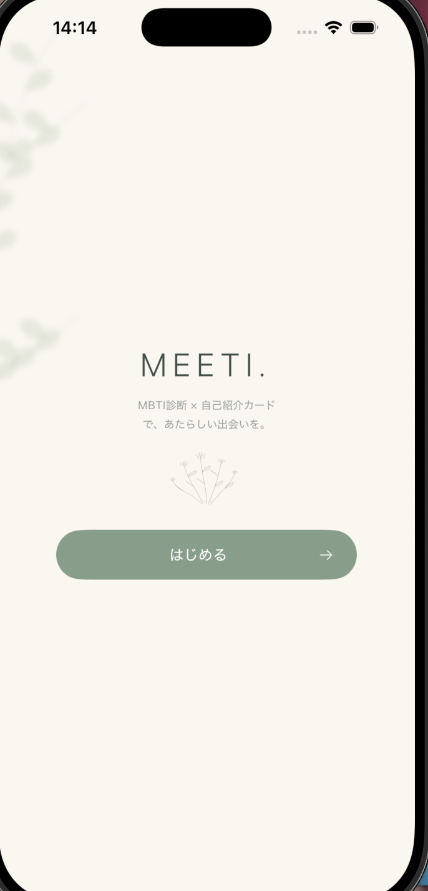
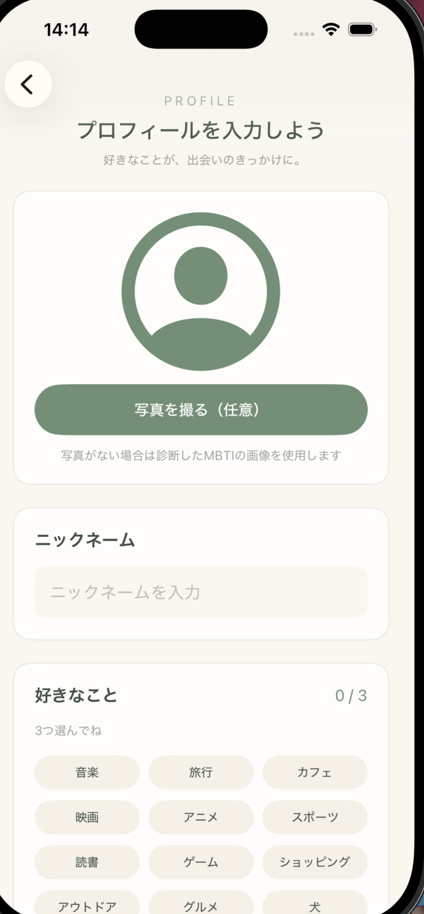
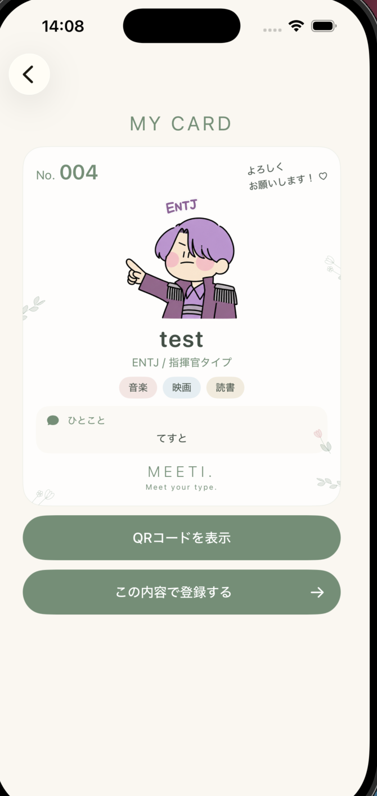
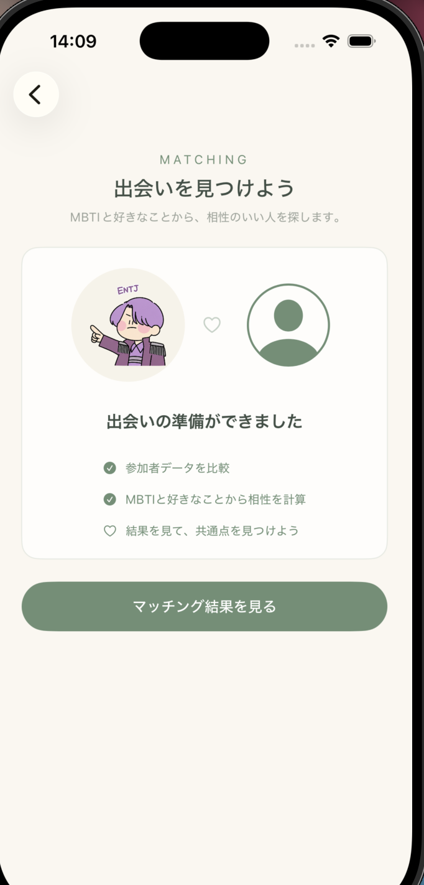

# 日専祭アプリ：MEETI〜mbti診断×自己紹介カード〜

> **AI利用レベル：** 2（生成コード可）
> **最終更新：** 2026-10-19
> **チーム：** MEETI（26CM0113 河野結奈、26CM0123 中島多笑、26CM0125 西村優里）
> 
---

## 何ができるアプリか（3行）

文化祭の来場者が、簡易MBTI診断と自己紹介から自分だけのデジタル名刺を作成できるアプリです。
その日の参加者データをもとに、MBTIや趣味などから相性の良い人を見つけることができます。
作成した名刺はQRコードを使って自分のスマートフォンに持ち帰ることができます。

## 画面
 
 
 
 

## 使った文法・技術
SwiftUI、`@State`、`NavigationLink`、`VStack`、`TextField`、`TextEditor`、`ForEach`、配列、`contains`、`append`、`removeAll`、`if`文、SwiftData、GitHub、Supabase

## 生成AIの使い方（どの場面で、どう使ったか）
画面の骨組みはChatGPTに書いてもらった。GitHubの使い方や、コンフリクトの解消方法を質問して解決した。

## 展示で工夫した点
初めて使う来場者でも迷わず操作できるように、プロフィール入力からMBTI診断、デジタル名刺の作成まで、順番に進められる画面構成を意識した。また、好きなことを3つ選べるようにし、来場者同士の共通点を見つけやすくした。
